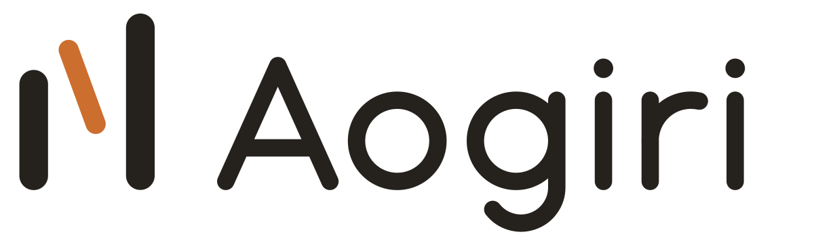

<div align="center">
  <picture>
    <source media="(prefers-color-scheme: dark)" srcset="design/brand/aogiri-horizontal-dark.svg">
    
  </picture>

  <h3>LynShen CLI</h3>

  <p>A coding agent in your terminal, and the engine behind the Aogiri desktop and phone apps.</p>

  <p>
    <a href="https://github.com/Libra1337/LynShen-CLI/releases/latest">Download</a> ·
    <a href="https://github.com/Libra1337/LynShen-CLI/releases">All releases</a> ·
    <a href="https://github.com/Libra1337/LynShen-CLI/issues">Report an issue</a>
  </p>

  <p><a href="README.md">简体中文</a> · <strong>English</strong></p>
</div>

The command is `lynshen`, written in Rust. Start it in a project directory and ask it in plain language to read code, edit files, and run commands and tests. The same binary also runs the background service `lynshen daemon`: every session of the [Aogiri desktop app](https://github.com/Libra1337/LynShen_Agent) and the phone runs in it, on LynShen, Claude Code, Codex, or an [ACP](https://agentclientprotocol.com) agent. Available for macOS, Linux, and Windows.

## Installation

| Platform | GitHub Releases file |
| --- | --- |
| macOS (Apple silicon) | `lynshen-aarch64-apple-darwin` |
| macOS (Intel) | `lynshen-x86_64-apple-darwin` |
| Linux x64 | `lynshen-x86_64-unknown-linux-gnu` |
| Windows x64 | `lynshen-x86_64-pc-windows-msvc.exe` |

Download the file and put it in a directory on your PATH. For example, on an Apple silicon Mac:

```sh
curl -fLo lynshen https://github.com/Libra1337/LynShen-CLI/releases/latest/download/lynshen-aarch64-apple-darwin
chmod +x lynshen
mkdir -p ~/.local/bin && mv lynshen ~/.local/bin/
lynshen --version
```

The same files are in the LynShen software library: `https://software.lynshen.org/cli/<version>/<file>`.

- **You already have the Aogiri desktop app:** it ships its own copy of the CLI (`~/.lynshen/bin`) and updates it with the app. Click "Use the lynshen command in a terminal" under Settings → Coding agents.
- **Linux:** install `bubblewrap` first (for example `sudo apt install bubblewrap`). The agent's shell commands run in its sandbox and fail without it; LynShen never falls back to running them unsandboxed.
- **npm:** the release workflow already packs `@lynshen/cli`, but the package is not on npm yet. Use the binaries above until it is.

**Updates.** `lynshen` (the TUI) and `lynshen serve` check the software library at startup. When a newer version exists, a release build downloads it in the background and replaces itself; it runs from the next start. A debug build only shows a notice. The version manifest is signed with Ed25519, and each file is checked against its sha256 before it replaces anything. Run `lynshen update` to update by hand. Set `"auto_update": false` in `~/.lynshen/config.json` to get only the notice. The desktop app's copy updates with the desktop app.

## Getting started

1. **Start.** Run `lynshen` in a project directory. The first run creates `~/.lynshen/config.json`. The default provider is the LynShen gateway and the default model is `gpt-5.5`.
2. **Sign in or configure a model.** Type `/login` in the TUI and pick a provider from the list:
   - **LynShen account:** `/login lynshen`. Your browser opens the [LynShen website](https://www.lynshen.org); approve access and return to the terminal. Model calls then use your account balance. `/usage` shows your plan, balance, and usage.
   - **Your own API key:** `/login <provider> <key>`, for example `/login deepseek sk-...`. `/login list` lists every provider, and `lynshen providers` prints them and their models as JSON.
   - **Subscription account:** some providers support browser sign-in, for example `/login openai-codex` for a ChatGPT subscription.
3. **Send a task.** Describe it in English or Chinese, for example "Fix the failing test in `cargo test` and explain the cause."

When you sign in with a LynShen account, the CLI receives credentials for this device, not your account password. `lynshen logout` signs out and revokes them.

## Everyday use

- **Control what the agent may do:** press `Shift+Tab` to cycle the approval modes `manual` → `plan` → `auto-edit` → `auto` → `full-access`, or use `/permissions <mode>`. An approval request offers allow once, always allow for this session, or deny. See "Approvals and sandbox" below.
- **The terminal interface (TUI):** input that starts with `!` runs in your local shell and is not sent to the model; `@` plus a few characters fuzzy-picks a file; `/image <path>` attaches an image; `Ctrl+T` cycles the reasoning effort; `Shift+Enter` adds a new line; `PageUp`/`PageDown` scroll the history. Each file in `~/.lynshen/commands/*.md` becomes a `/<file name>` command, with `$ARGUMENTS` replaced by the text after the command.
- **Keep talking while the agent works:** a message sent during a turn is queued and starts the next turn. With an empty input, `↑` takes the last queued message back to edit. `Esc` interrupts the current turn; queued messages still run. The desktop app and the `serve` protocol can also steer a queued message into the running turn without stopping the tools that run.
- **Rewind and fork:** `/rewind` takes the conversation, and the files this session changed, back to an earlier turn. `/tree` shows the conversation tree; `/fork` and `/checkout` branch and switch inside the same session. The desktop app's "Fork from here" has the daemon copy the conversation into a separate new session, optionally in a new git worktree.
- **Several engines:** the daemon hosts LynShen, Claude Code, Codex, and ACP agent sessions and turns them into one event stream. OpenCode (1.x), oh-my-pi, and Pi are built-in ACP agents: install one and use it, with no command to register. When one is missing or has an unsupported version, the error says what to install. Pi never asks for approval, so it runs only in full-auto mode. You can register other ACP agents yourself.
- **Background service:** `lynshen daemon` hosts many sessions on `ws://127.0.0.1:7788`, and sessions keep running after every client disconnects. `lynshen daemon install` starts it at login (launchd on macOS, a systemd user service on Linux); `uninstall` removes that. The client token is in `~/.lynshen/daemon/token` and the log in `~/.lynshen/daemon/daemon.log`.
- **Scheduled tasks:** a long-lived agent (`~/.lynshen/agents/<id>/`) can receive a task automatically: once, hourly, daily, on weekdays, or weekly. Create and manage them in the desktop app; the phone can view them and run one now. Each run can start a new session (optionally in a new git worktree) or continue the last one, and can have a cost cap. A task switches itself off after 3 failures in a row, and the last 20 runs are kept. While a task runs, the daemon keeps the computer from idle sleep. A task the agent proposes itself takes effect only after you turn it on.
- **Skills and MCP:** skills load from `~/.lynshen/skills`, `~/.agents/skills`, and a trusted project's `.lynshen/skills` and `.agents/skills`. `/skills` lists, installs, updates, enables, and disables them ([docs/skills.md](docs/skills.md)). MCP servers go in the `mcp_servers` list of `config.json`, over stdio or HTTP, and `/mcp` manages them ([docs/mcp.md](docs/mcp.md)). A project's local resources load only after you trust the project with `/trust yes`.
- **Run Claude Code and Codex on your own API:** the daemon can run a Claude Code or Codex session on an API you bring (URL, key, model); add one under Settings → Coding agents in the desktop app. Requests go only to that provider with its own key, carry no LynShen token and no `X-LynShen-*` header, and do not count toward your LynShen account's usage. A session keeps the provider it started with. See "Custom providers" in [docs/daemon-protocol.md](docs/daemon-protocol.md).
- **Headless and protocol modes:** `lynshen --headless "<task>"` runs one task and prints JSONL events, ending with `final_result`. It defaults to `manual` and denies anything that needs approval; pass `--approval-mode` to let it edit files or run commands. `lynshen serve` speaks newline JSON over stdio ([docs/serve-protocol.md](docs/serve-protocol.md)), and `lynshen acp` connects LynShen to ACP editors such as Zed ([docs/serve-vs-acp.md](docs/serve-vs-acp.md)).

### Common commands

| Command | What it does |
| --- | --- |
| `/model [model] [effort]` | Show or switch the model and reasoning effort |
| `/permissions [mode]` | Show or switch the approval mode |
| `/sandbox [mode]` | Show or switch the shell command sandbox |
| `/style [style] [--global]` | Show or switch the reply style; `--global` also makes it the default for new conversations |
| `/resume [session id]` | List or resume earlier sessions (or `lynshen --resume <id>`) |
| `/rewind [turn id]` | Take the conversation and files back to an earlier turn |
| `/context`, `/compact` | Show context usage; compact the context now |
| `/goal <goal>` | Set a goal that spans turns |
| `/skills`, `/mcp` | Manage skills and MCP servers |
| `/usage` | Your LynShen plan, balance, and usage |
| `/doctor` | Check the environment |
| `/new`, `/quit` | New session; quit |

### Approvals and sandbox

| Mode | Edit files | Run shell commands |
| --- | --- | --- |
| `manual` (default) | Asks | Asks |
| `plan` | No edits: read-only research, then a plan | Read-only |
| `auto-edit` | Edits | Asks |
| `auto` | Edits | Runs commands a safety model judges safe; asks for the rest |
| `full-access` | Edits | Runs everything without asking |

When a plan is ready, approve it and pick `auto-edit`, `manual`, or `auto` to start, or write what to change and get a new version. Press `Esc` to leave it for later and `/plan` to bring it back.

On macOS (Seatbelt) and Linux (bubblewrap), shell commands run in a sandbox. The default, `workspace-write`, allows writes only to the working directory, the directories you configure, temp directories, and package caches; `.git` stays read-only, and paths such as `~/.ssh`, `~/.aws`, and `~/.lynshen/auth.json` cannot be read. By default `git add` and `git commit` may leave the sandbox, and `git push` always asks. Windows has no OS sandbox by default; an opt-in preview exists. `full-access` runs with your user's permissions and is not confined to the working directory: use it only in repositories you trust. See [docs/sandbox.md](docs/sandbox.md).

### Your own provider and models

`provider`, `base_url`, `protocol` (`responses`, `anthropic`, or `chat`), and `models` in `config.json` describe the provider the LynShen engine uses:

```json
{
  "provider": "my-llm",
  "base_url": "https://llm.example.com/v1",
  "protocol": "chat",
  "model": "my-model",
  "models": [
    {
      "name": "my-model",
      "context_window": 200000,
      "max_output_tokens": 32000,
      "reasoning_efforts": ["low", "medium", "high"],
      "input_modalities": ["text", "image"]
    }
  ]
}
```

A model entry can also set `display_name` and `reasoning` (`false`: requests carry no reasoning settings). `reasoning_efforts` takes `none`, `low`, `medium`, `high`, `xhigh`, `max`, and `ultra`. Without `image`, images sent to the model are replaced by a one-line note. See [docs/serve-protocol.md](docs/serve-protocol.md) for the fields.

## Remote access

Remote access is off by default. A phone reaches the daemon on your computer in one of these ways:

- **Relay v2 (account):** when the desktop app on this computer is signed in to a LynShen account, the daemon registers as one of the account's computers once the relay is on. Only phones signed in to the same account can connect. A new phone uses a pairing code or sends a connect request that you confirm in the desktop app. When v2 cannot be reached, the daemon uses v1 for 10 minutes, then tries v2 again.
- **Relay v1 (pairing):** `lynshen daemon relay on` turns the relay on (`off` turns it off, `status` shows it), and `lynshen daemon pair` prints a one-time pairing link to open on the phone within 5 minutes. Then compare the 6-digit check code both sides show and confirm it on the computer (in the desktop app).
- **LAN and Tailscale direct (advanced):** keep the daemon on `127.0.0.1` and expose the port over HTTPS with `tailscale serve` or a reverse proxy. New direct pairings need the computer to be signed in to LynShen.

Relay connections are end-to-end encrypted (Noise); the relay cannot read them. You can revoke a paired device at any time. A device can view, send messages, and handle ordinary approvals by default; full-auto, running outside the sandbox, and other elevated scopes are granted per device on the computer. See [docs/daemon-protocol.md](docs/daemon-protocol.md) and [docs/relay-protocol.md](docs/relay-protocol.md). The daemon can also connect Telegram, Discord, and QQ bots; see [docs/chat-connectors.md](docs/chat-connectors.md).

## Data and privacy

- Prompts, code, and attachments go to the model provider of the current session: the LynShen gateway or the provider you configured. When Claude Code or Codex runs on a custom provider, requests go only to that provider, with no LynShen account details.
- Credentials are stored in plaintext in `~/.lynshen/auth.json` (mode 0600) by default. `"encrypt_secrets": true` in `config.json` turns on encryption at rest, but it does not protect against programs running as you. Read [docs/secrets.md](docs/secrets.md) before you enable it.
- While you are signed in to a LynShen account, the daemon uploads each turn's session ID, engine, model, request count, token usage, and start and end times to the account, so every computer on the account shows the same totals. Prompts, code, and project paths are not uploaded. Turns on a custom provider stay on this computer: they are not uploaded and do not count as gateway use.
- Some requests to LynShen account endpoints (relay v2, feedback, and the desktop app's gateway requests once signed in) carry a device identifier, used to count the account's computers. It is an HMAC hash of hardware IDs and does not contain the raw IDs.
- `web_search` tries, in order: the model provider's own search, the LynShen gateway's search, then web results from Bing, DuckDuckGo, and Sogou requested from this computer.
- The CLI checks for and downloads updates from `software.lynshen.org`. Chat bot messages go directly between the daemon and the chat platform, not through LynShen servers.

## Troubleshooting

- Run `/doctor` first. The log is `~/.lynshen/logs/lynshen.log`; the daemon log is `~/.lynshen/daemon/daemon.log`.
- **Every shell command fails on Linux:** install `bubblewrap`. On Ubuntu 24.04 and later, also allow unprivileged user namespaces (`sudo sysctl -w kernel.apparmor_restrict_unprivileged_userns=0`, or an AppArmor profile for bwrap), or switch to `full-access`.
- **macOS blocks a binary downloaded in a browser:** run `xattr -d com.apple.quarantine <file>`. A download with `curl` is not blocked.

For other problems, open a [GitHub issue](https://github.com/Libra1337/LynShen-CLI/issues) with the output of `lynshen --version`, your operating system, and the relevant part of the log. Do not paste API keys or access tokens. Desktop users can also use Settings → General → Report Issue.

## Build from source

You need stable Rust. `crates/llm-provider-kit` is a git submodule, so clone with `--recurse-submodules`:

```sh
git clone --recurse-submodules https://github.com/Libra1337/LynShen-CLI.git
cd LynShen-CLI
cargo build --release
./target/release/lynshen --version
```

When `CARGO_TARGET_DIR` is set, the build output is in `$CARGO_TARGET_DIR/release/`, not `./target/`. Several worktrees that share one `CARGO_TARGET_DIR` avoid compiling the same crates again.

The relay is in `relay/`, written in Go: `cd relay && go build -o lynshen-relay .`. See [relay/README.md](relay/README.md).

Common checks:

```sh
cargo fmt --check
cargo clippy --workspace --all-targets -- -D warnings
cargo test --workspace
```

The full test suite on Linux needs `ripgrep`, `bubblewrap`, and unprivileged user namespaces. Code layout: `src/main.rs` is the command-line entry point; `crates/agent-core` holds the agent loop, tools, configuration, sandbox, skills, and MCP; `crates/tui` the terminal interface; `crates/daemon` the background service; `crates/llm-provider-kit` the provider protocols and model catalog. See [AGENTS.md](AGENTS.md) for development conventions, and [docs/releasing.md](docs/releasing.md) and [docs/software-library.md](docs/software-library.md) for releases.

## License

Code is licensed under the [Apache License 2.0](LICENSE); see also [NOTICE](NOTICE). `crates/llm-provider-kit` contains code and data from [oh-my-pi](https://github.com/can1357/oh-my-pi) under the MIT license; see [its NOTICE](https://github.com/Libra1337/llm-provider-kit/blob/main/NOTICE). The LynShen name and logo trademarks belong to LynShen Innovations INC. Third-party agents and tools belong to their respective owners.
